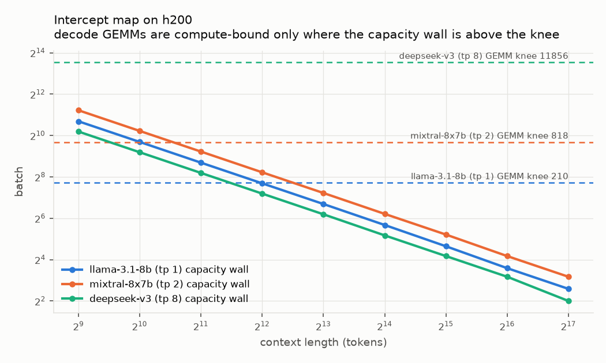
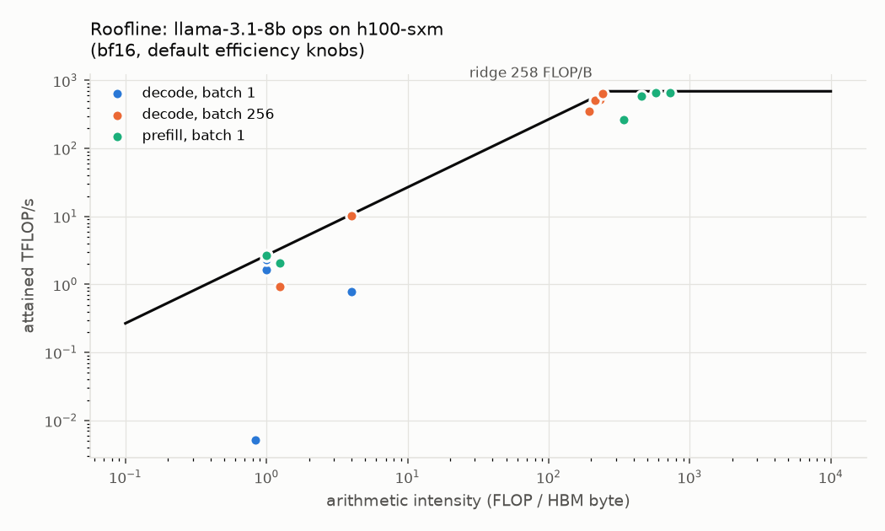
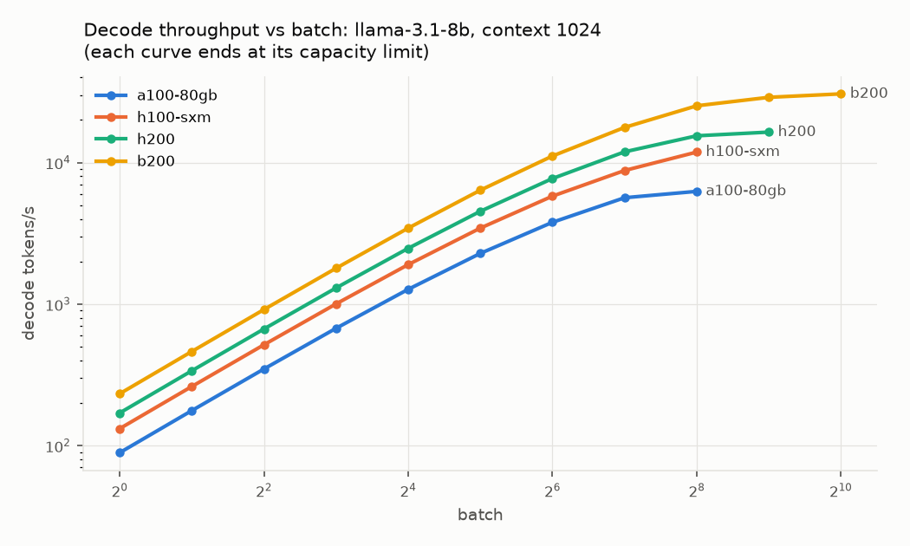
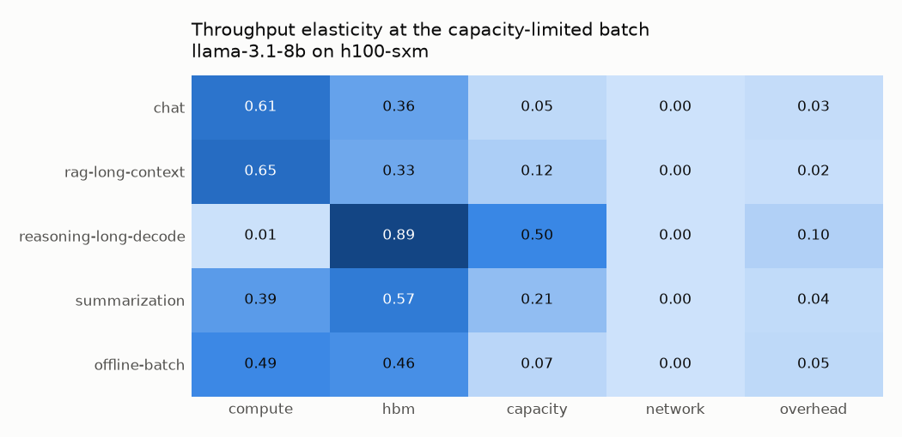
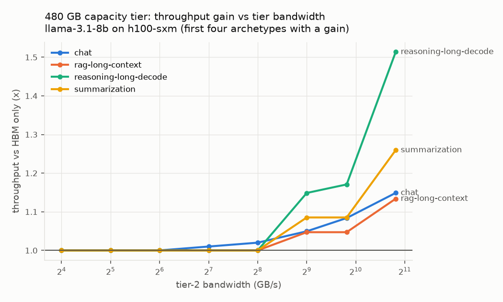
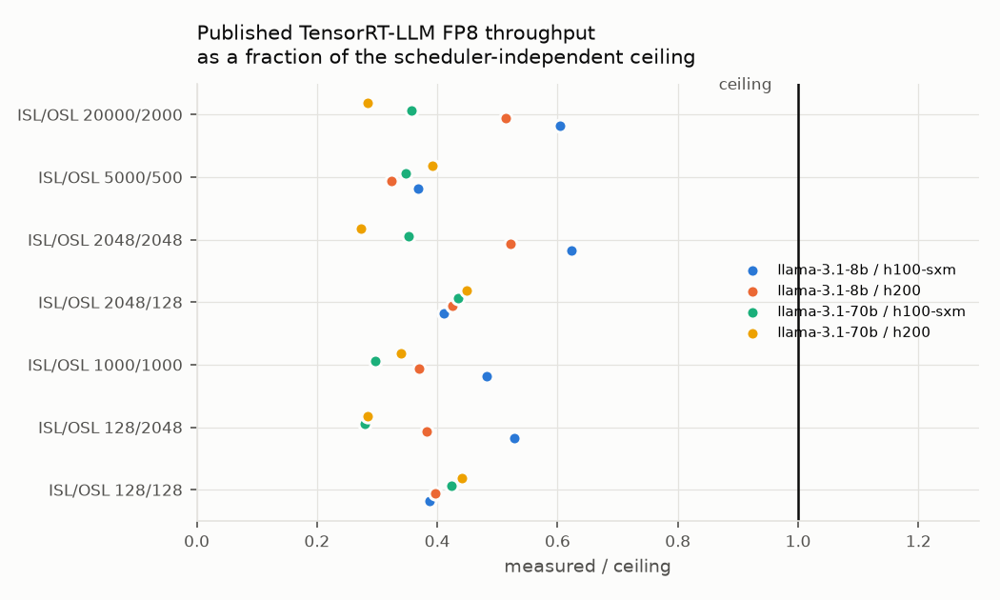
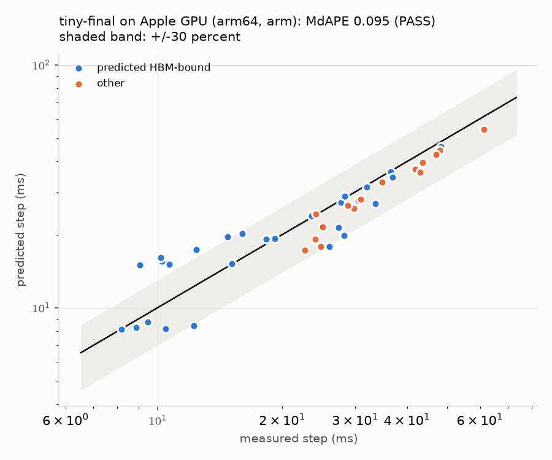

# LLMBottleneckAnalyzer

**Which resource is on an LLM inference workload's critical path, and at what batch size, context length, or parallelism does that answer change?**

`llmba` is a local-first Python tool for LLM inference workload characterization and critical-path analysis.
It models how model architectures (dense GQA, MLA, MoE) and batch sizes interact with HBM bandwidth, HBM capacity, a capacity memory tier, compute, interconnect, and kernel-launch overhead.
It then turns that into intercepts (crossover points) and ranked recommendations for next-generation memory-system design.

The analytical engine uses only the Python standard library.
Its claims are tested: parameter accounting against published counts, elasticity math against finite differences, a scheduler-independent throughput ceiling against published measurements, and an out-of-sample predict-then-measure loop on a real GPU.



## What it answers

| Question | Command |
| --- | --- |
| Where does time go for this model, GPU, and workload, and which resource binds each op? | `llmba analyze` |
| At what batch do decode GEMMs turn compute-bound, and does it fit in memory? | `llmba intercepts` |
| Which hardware or software change buys the most latency or throughput for a workload class? | `llmba recommend` |
| Synthesize a characterization dataset over a grid, with a content-addressed manifest | `llmba sweep` |
| Full study report with figures | `llmba report` |
| Is the model consistent with published measurements? | `llmba check-published` |
| Does the methodology predict a real device? | `llmba measure calibrate` then `llmba measure validate` |

## Quickstart

```bash
uv venv --python 3.12 .venv
uv pip install --python .venv/bin/python -e ".[dev,plot]"   # add ",measure" for torch
.venv/bin/llmba presets
.venv/bin/llmba analyze --model llama-3.1-70b --hw h100-sxm --tp 4 --batch 64 --prompt 2048 --output 512
```

```text
llama-3.1-70b on h100-sxm  batch=64 prompt=2048 output=512 tp=4 weights=bf16 kv=bf16
  params 70.55B total, 70.55B active; weights/rank 35.3 GB; KV 13.4 GB; fits=True (max batch 175)
  TTFT 8.31 s  TPOT 29.1 ms  e2e 23.2 s  decode 2198 tok/s  output 1411 tok/s

  prefill: time share (= elasticity) compute 80%  hbm 3%  network 17%
  decode: time share (= elasticity) hbm 62%  network 19%  overhead 19%
    op                share     bound
    mlp               42.9%       hbm
    attention         21.0%       hbm
    attn_allreduce    10.5%   network
    ...
```

Other workflows:

```bash
llmba intercepts --model mixtral-8x7b --hw h100-sxm --tp 2 --prompt 4096
llmba recommend --study studies/next_gen_memory.json
llmba sweep --models llama-3.1-8b,mixtral-8x7b --hw h100-sxm,h200 --batch 1,8,64,256 --out results/sweep
llmba report --study studies/next_gen_memory.json --out results/report
llmba check-published
llmba analyze --model llama-3.1-8b --hw h100-sxm --set hbm_gbps=6700 --set compute_eff=0.6 --json
```

Every command that prints a table accepts `--json`.
Exit codes: 0 ok, 1 a gate failed, 2 usage or spec error, 3 requested device unavailable.
Output directories are never overwritten unless `--force` is given.

## Bundled presets

Models (architecture hyperparameters from public Hugging Face configs, URLs in each preset): Llama-3.1-8B, Llama-3.1-70B, Llama-2-7B (MHA baseline), Mixtral-8x7B (MoE), DeepSeek-V3 (MLA plus MoE).
Hardware (vendor datasheets, dense tensor throughput): A100-80GB, H100 SXM, H200, B200, L4, MI300X.
Fields not stated by a primary source are listed in `unverified` and surfaced in outputs.
Custom specs are JSON files validated strictly (unknown keys, bad units, and inconsistent head counts are rejected with the field name).

## Findings from the bundled study

From `llmba report --study studies/next_gen_memory.json`, based on datasheet specs and assumed default efficiencies (model outputs, not measurements):

- **Longer context and more experts push the compute-bound knee past the capacity wall.**
  On H200 the Llama-3.1-8B weight-GEMM knee (batch 210) fits in memory only up to 2k context, and Mixtral-8x7B's (TP2, near batch 818, because every touched expert is streamed) only up to 1k.
  DeepSeek-V3's (fp8, TP8, 256 experts) sits near batch 11,856, above the capacity wall at every studied context, so its decode is never compute-bound.
- **GQA decode never becomes compute-bound as a whole step.**
  Attention's arithmetic intensity is fixed at `2H/(Hkv*b)` (4 FLOP/byte for Llama-3.1-8B in bf16), so KV traffic grows with batch as fast as FLOPs do.
- **The binding resource flips with the workload class.**
  For Llama-3.1-8B on H100, chat and long-context RAG throughput is most sensitive to compute (prefill dominates); for Mixtral-8x7B on H100 the same archetypes are most sensitive to HBM capacity.
  Long-reasoning decode is bandwidth- and capacity-bound: an fp8 KV cache nearly doubles its throughput (x1.97).
  For Mixtral and DeepSeek-V3 on long decode, throughput elasticity to HBM capacity exceeds 2.
- **A capacity memory tier helps only above a bandwidth intercept.**
  A 480 GB tier behind a link raises Llama-3.1-8B throughput on H100 only above about 405 to 425 GB/s for long-context, summarization, and reasoning archetypes, but above 43 to 89 GB/s for short-context chat and offline batch.

| | |
| --- | --- |
|  |  |
|  |  |

## Validation

| Claim | Test | Result |
| --- | --- | --- |
| S1 parameter accounting | computed vs published parameter counts, 5 models | exact for all published safetensors totals (Llama, Mixtral); DeepSeek-V3 total +0.004 percent; DeepSeek-V3 active +1.49 percent vs the rounded "37B" (tolerance disclosed in `docs/validation.md`) |
| S2 elasticity math | analytic time shares vs central finite differences, 200 seeded operating points | pass (tolerance 0.02) |
| S3 published ceiling | 28 TensorRT-LLM FP8 throughput rows (Llama 3.1 8B TP1, Llama 3.3 70B TP2, H100 and H200) vs a scheduler-independent ceiling | **PASS**: every row is below the ceiling, at 0.27 to 0.62 of it (median 0.39) |
| P1 closed loop on real hardware | calibrate an Apple M2 GPU from microbenchmarks, predict a frozen, never-measured 317M-parameter decoder twin over 45 (batch, context) points | **PASS** on the single final attempt: median error 9.5 percent (95 percent CI 7.4 to 20.1), knee within one grid step, a 4x-bandwidth negative control rejected |





The P1 protocol was pre-registered: the final twin and grid were frozen and hashed before any twin was measured, calibration uses only standalone microbenchmarks on generic shapes, and no knob was fitted to twin measurements.
Development runs on a different twin initially failed (median error 53 percent).
That failure exposed Apple MPS kernel behavior: matmul efficiency collapses near 8 rows, and decode attention attains about a third of copy bandwidth.
The fix was operator-level calibration.
The full record, including every development run and per-point final results, is in [`docs/validation.md`](docs/validation.md).
The largest remaining residuals are systematic: 5 of 8 batch-2 points are over-predicted by 40 to 66 percent (the standalone M=2 calibration shows an efficiency dip the twin does not), and three valid batch-1 points are under-predicted by about 30 percent.

## How it works

Specs are loaded and validated, an operator graph is built per phase with FLOPs and bytes, and each op is costed with a roofline over compute, HBM, capacity tier, network, and launch overhead.
Phases aggregate into TTFT, TPOT, throughput, critical path, and elasticities; intercept solvers and what-ifs run on top.
Every equation and assumption is in [`docs/methodology.md`](docs/methodology.md); the engineering contract is [`BUILD_PLAN.md`](BUILD_PLAN.md).

```text
src/llmba/
  specs.py       strict JSON specs and presets
  ops.py         operator graph (GQA, MLA, MoE, TP all-reduce, capacity tier)
  cost.py        roofline cost, bound classes, overhead modes
  analyze.py     requests, capacity, critical path, elasticities, S3 ceiling
  intercepts.py  knees, walls, TP saturation, what-ifs, recommendations
  sweep.py       dataset synthesis with content-addressed manifests
  report.py      study report and figures
  measure.py     calibration, executable twin, P1 grading
  cli.py         command-line interface
```

## Prior art

LLM-Viewer (per-layer roofline analysis), LLMCompass and GenZ (hardware evaluation frameworks), llm-analysis (latency and memory estimates), and Vidur (serving simulation with profiled operators) cover overlapping ground.
This project's owned contributions are:
- intercept solving and exact elasticity attribution as critical-path time shares;
- MoE expected-distinct-expert traffic, MLA latent-cache accounting, and a capacity memory tier in one engine;
- a scheduler-independent throughput ceiling checked against published measurements;
- a pre-registered predict-then-measure loop with a negative control.

## Limitations

- First-order analytical model: compulsory HBM traffic, no on-chip cache model, no cycle accuracy.
- Datacenter GPU numbers are predictions from datasheet specs with assumed default efficiencies (compute 0.7, memory 0.8, network 0.8, 4 us per kernel launch); calibrate them with `--set` or a measured profile for a real target.
- Throughput what-ifs assume static batching; MoE assumes uniform independent routing.
- The empirical check ran on an Apple M2 GPU with LPDDR unified memory: it supports the methodology, not HBM or NVIDIA accuracy.
  Running `llmba measure calibrate` and `validate` on a CUDA device is a follow-on.

## Tests

```bash
.venv/bin/ruff check src tests
.venv/bin/python -m pytest
```

The suite covers golden accounting, property and metamorphic checks, fault injection for malformed specs, CLI exit codes, manifest determinism, report consistency, and the P1 gate logic.
